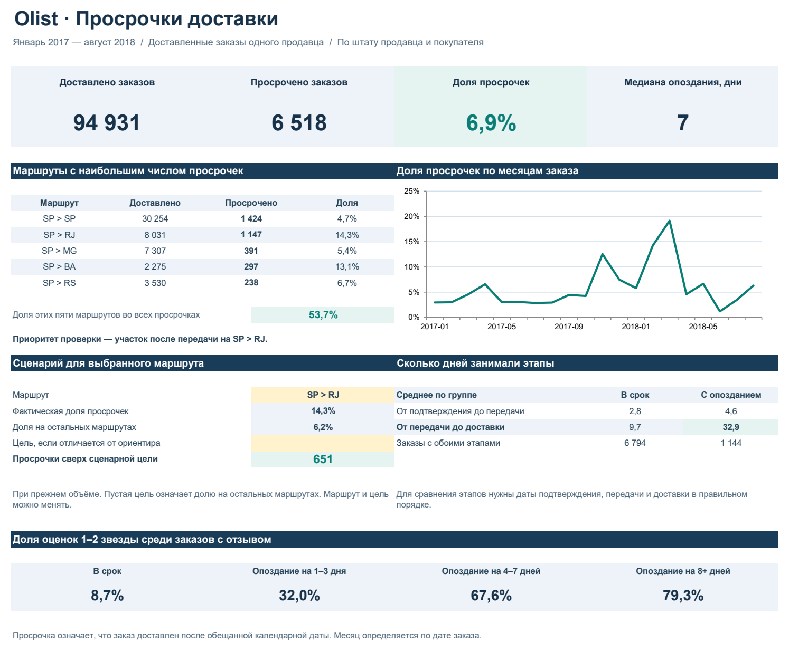
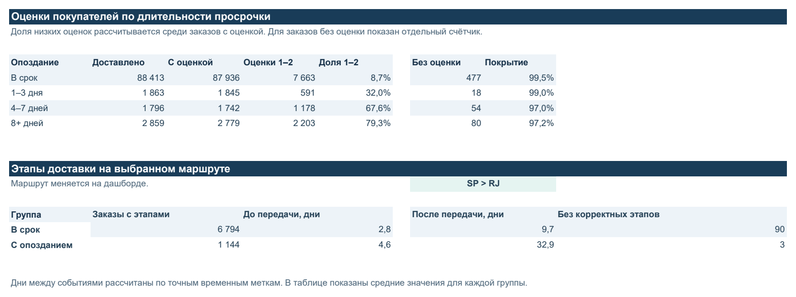
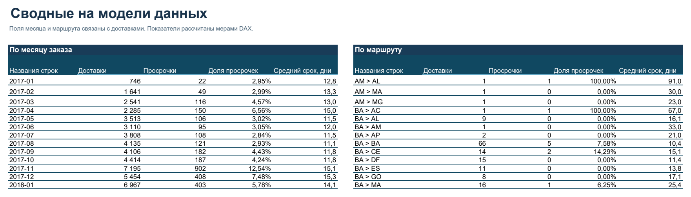

# Olist · Анализ просрочек доставки в Excel

**Какой маршрут стоит проверить первым и на каком этапе искать задержки?** Анализ охватывает 94 931 доставленный заказ бразильского маркетплейса Olist. Заказы оформлены с января 2017 по август 2018 года. В Excel можно сравнить маршруты, поменять целевую долю просрочек и посмотреть, скольким заказам соответствует разница при прежнем объёме.

[Скачать книгу Excel](olist-delivery-analysis.xlsx?raw=true) · [Запросы Power Query](power-query/)



## Что показали данные

| Наблюдение | Результат |
| --- | --- |
| Просрочки по всей выборке | **6 518 из 94 931**, или **6,87%**. Среди просроченных доставок медиана опоздания — **7 дней**. |
| Концентрация просрочек | Пять лидирующих маршрутов дают **3 497 просрочек**, или **53,65%** общего числа. На `SP > SP` приходится больше всего просрочек (**1 424**), при этом его доля (**4,71%**) ниже общей. |
| Приоритет для проверки | `SP > RJ` (Сан-Паулу → Рио-де-Жанейро) дал **1 147 просрочек из 8 031** (**14,28%**). На остальных маршрутах было **5 371 из 86 900** (**6,18%**). На этот маршрут приходится **17,60%** всех просрочек выборки. |
| Помесячный пик | В марте 2018 года опоздали **1 324 из 6 913** доставленных заказов, оформленных в этом месяце (**19,15%**). Это самая высокая доля за 20 месяцев. |

На `SP > RJ` стоит первым проверить **интервал от передачи перевозчику до вручения**. Среди заказов с корректными отметками об обоих этапах этот интервал составлял в среднем **32,9 дня** у опоздавших и **9,7 дня** у доставленных вовремя. Разница — **23,2 дня**. На этапе от подтверждения до передачи разница составила **1,8 дня** (4,6 против 2,8). Сравнение основано на **1 144 опоздавших** и **6 794 своевременных** доставках. Для следующей проверки нужны трекинг отправлений, данные о перевозчиках и переходах между сортировочными центрами, чтобы установить, где именно накапливалась задержка.

При прежнем объёме (**8 031** доставка) снижение доли просрочек на `SP > RJ` до фактического уровня остальных маршрутов (**6,18%**) дало бы **примерно на 651 просрочку меньше**. В книге используется полная точность доли до округления результата. Различия между маршрутами по расстоянию, обещанным срокам или составу заказов влияют на сопоставимость этого ориентира.

### Просрочка и оценки

| Опоздание | Заказы с оценкой | Оценки 1–2 | Доля 1–2 |
| --- | ---: | ---: | ---: |
| В срок | 87 936 | 7 663 | 8,7% |
| 1–3 дня | 1 845 | 591 | 32,0% |
| 4–7 дней | 1 742 | 1 178 | 67,6% |
| 8+ дней | 2 779 | 2 203 | 79,3% |

Доля низких оценок растёт вместе с длительностью просрочки. Это наблюдаемая связь. Оценка отражает весь опыт покупки, а свойства товаров, продавцов и маршрутов могут различаться между группами. Оценка доступна для **94 302 из 94 931** заказов, то есть для **99,3%** выборки.



## Источник и отбор заказов

Использована версия 2 **Brazilian E-Commerce Public Dataset by Olist**. Это обезличенные коммерческие данные. Для проекта нужны пять файлов из архива. [Olist на Kaggle](https://www.kaggle.com/datasets/olistbr/brazilian-ecommerce)

| CSV | Что используется |
| --- | --- |
| `olist_orders_dataset.csv` | Идентификатор, статус, время заказа, подтверждения, передачи и доставки, обещанная дата. |
| `olist_order_items_dataset.csv` | Связь заказа с одним или несколькими продавцами через товарные позиции. |
| `olist_sellers_dataset.csv` | Штат продавца. |
| `olist_customers_dataset.csv` | Штат покупателя. |
| `olist_order_reviews_dataset.csv` | Оценка, идентификатор и временные метки отзыва. |

Из **99 441** заказа последовательно исключены **349** вне периода, **2 881** со статусом, отличным от `delivered`, **8** с неполными или противоречивыми датами и **1 272** без ровно одного продавца. После этих условий исключений по отсутствующему штату не было. Порядок фильтров исключает повторный учёт одной строки в нескольких причинах. Сумма исключений и включённых заказов сходится с объёмом исходного файла.

### Правила расчёта

- **Просрочка.** Из календарной даты доставки вычитается обещанная календарная дата. Положительная разница означает просрочку. Доставка в день обещания считается своевременной. Месяц в отчёте относится к дате оформления заказа. Общая доля — число просрочек, делённое на число включённых доставок.
- **Маршрут.** Штат продавца → штат покупателя, включая доставки внутри штата. Сначала товарные строки сводятся к уникальным парам «заказ — продавец». Заказ с несколькими позициями одного продавца остаётся одной доставкой. Пары штатов ранжируются по числу просрочек.
- **Этапы.** Из времени передачи вычитается время подтверждения. Из времени вручения вычитается время передачи. Для обоих средних берутся только заказы с отметками в порядке «оформление → подтверждение → передача → вручение». Таких заказов **93 599**. Остальные **1 332** участвуют в расчёте доли просрочек.
- **Отзывы.** Для заказа выбирается последняя валидная оценка по времени ответа. При равных отметках используются дата создания, идентификатор и балл в порядке убывания. Доля оценок 1–2 рассчитывается среди заказов с оценкой в соответствующей группе. Тексты отзывов в книгу не загружаются.
- **Сценарий.** Ориентир рассчитывается по всем прочим маршрутам как отношение числа просрочек к числу доставок. Из фактического числа просрочек на выбранном маршруте вычитается его объём, умноженный на целевую долю. Результат округляется до ближайшего целого и ограничивается снизу нулём. Свою цель можно ввести в жёлтую ячейку на дашборде.

## Как устроена книга

| Лист | Содержание |
| --- | --- |
| **Дашборд** | KPI, пять крупнейших маршрутов по числу просрочек, динамика по месяцам, выбор маршрута и сценарий. |
| **Маршруты** | Все **408** направлений с объёмами доставок, числом и долей просрочек. |
| **Формулы** | Помесячные расчёты, показатели выборки, разрез по отзывам и этапам. |
| **Сводные** | Две сводные таблицы Power Pivot по месяцу оформления и паре штатов. |
| **Заказы** | Детализация на уровне заказа с фильтрами, датами, вычисленными интервалами и оценкой. |
| **Источники** | Параметр обновления, объёмы на шагах отбора и сверка итогов. |

**Power Query.** `SourceFiles` и `SourceCsv` читают пять CSV из папки `DataFolder` с кодировкой UTF-8. `OrdersScope` типизирует даты, соединяет заказы со справочниками и присваивает причину включения или исключения. `FactDelivery` присоединяет одну оценку на заказ, вычисляет сроки и признаки. Производные запросы загружают детализацию, итоги по маршрутам, справочники и сверку. Код M доступен в [power-query](power-query/).

**Формулы Excel.** `СУММ`, `СЧЁТ`, `СЧЁТЗ`, `СРЗНАЧ`, `МИН`, `МАКС` и `МЕДИАНА` считают показатели всей выборки. Семейства `СЧЁТЕСЛИ`, `СУММЕСЛИ` и `СРЗНАЧЕСЛИ`, включая функции с несколькими условиями, используются для разрезов и этапов. `МИНЕСЛИМН`, `МАКСЕСЛИМН` и `МЕДИАНА` с `ФИЛЬТР` показывают крайние значения и медиану среди просроченных доставок. `ПРОСМОТРX` получает показатели по выбранному маршруту из таблицы маршрутов. `ЕСЛИ`, `И`, `ИЛИ` и `ЕСЛИОШИБКА` обрабатывают ввод и пустые группы. `ПРОМЕЖУТОЧНЫЕ.ИТОГИ` показывает объём детализации с учётом фильтра на листе **Заказы**.

**Power Pivot.** Справочники `DimMonth[Month]` и `DimRoute[Route]` связаны с `FactDelivery` отношениями «один ко многим». Обе сводные используют четыре меры. Деление в мере даёт корректный взвешенный итог при любом фильтре.

```dax
Доставки := COUNTROWS(FactDelivery)
Просрочки := SUM(FactDelivery[Late])
Доля просрочек := DIVIDE([Просрочки], [Доставки])
Средний срок, дни := AVERAGE(FactDelivery[ActualDays])
```



## Как открыть и обновить

1. Скачайте [книгу Excel](olist-delivery-analysis.xlsx?raw=true) и откройте её в настольном Microsoft Excel для Windows с поддержкой Power Pivot и `ПРОСМОТРX`. Отчёт, детализация и сводные уже содержат сохранённые данные.
2. Для повторной загрузки скачайте [архив Olist](https://www.kaggle.com/datasets/olistbr/brazilian-ecommerce) и распакуйте пять перечисленных CSV в одну локальную папку.
3. Откройте **Данные → Запросы и подключения**. Откройте любой запрос в редакторе Power Query. В **Главная → Управление параметрами** укажите полный путь к папке в `DataFolder`.
4. Закройте редактор с применением изменений и выберите **Данные → Обновить всё**. После обновления откройте лист **Источники**. Три разницы внизу должны быть равны нулю.

Книга использует встроенный Power Query и модель данных Excel. Исходные CSV исключены из репозитория. Датасет Olist используется по лицензии [CC BY-NC-SA 4.0](https://creativecommons.org/licenses/by-nc-sa/4.0/), и эта же лицензия применяется к производным данным и визуализациям. [Описание источника и условий на Kaggle](https://www.kaggle.com/datasets/olistbr/brazilian-ecommerce)
